## 통일 스타일 규격

시험지 인쇄용 흑백 선화. 수학 도형(검은 선 1.9)보다 약하게 표현한다.

- 선 색은 `#333333` 하나만 사용한다.
- 채움은 `#ffffff`(기본 면), `#ececec`(지붕·창·두 번째 면), `#c6c6c6`(소량의 어두운 부분), `#333333`(원래 검은 물체), `none`만 허용한다.
- 굵기는 바깥 윤곽 1.4, 안쪽 세부선 1. 모든 선의 linejoin·linecap은 round.
- 그라데이션·투명도·질감·작은 장식·얼굴 이목구비를 추가하지 않는다. 기존 에셋도 새 12종과 같은 간결한 윤곽과 필수 세부만 사용한다. 바닥 땅선과 물결선은 넣지 않는다.
- 새 그림의 기하 외곽은 viewBox에서 선 굵기 절반(0.7)만큼 안쪽에 둔다.

# 실물 에셋 목록

`assetScene` kind(figure_assets.py) 가 합성에 쓰는 자작 SVG 39종.
규격·검증은 `figure_assets.py` 가 강제한다 (허용 태그만 · text/id/href/url 금지).

목록은 manifest와 일치하도록 유지한다(아래 표는 manifest-*.json·anchors.json·picture-assets.json 에서 만든다).

- **명세 assets**(○) — FigureSpec v2·graph-1 의 `assets` 로 쓸 수 있는 조각. 도형으로 그릴 수 없는 실물만이고 목록은
  `picture-assets.json` 한 파일(지시문 `src/lib/figure/assetCatalog.ts` 와 엔진 `scene_assets.py` 가 같이 읽는다).
  컵·캔·주사위·그릇·관람차처럼 원기둥·직육면체·구·원으로 그릴 수 있는 것(—)은 초등 실물 장면 `elem-1 assetScene` 에서만.
- **기준점** — `anchors.json`(viewBox 좌표, 잉크로 잰 값). base = 땅에 닿는 바닥 가운데, top = 높이 문제의 꼭대기,
  center = 잉크 상자 가운데. `{"asset":…,"from":D,"to":C}` 는 base 를 D 에, top 을 C 에 맞춘다.

| 미리보기 | slug | 이름 | viewBox | 명세 assets | 기준점 | tags |
|---|---|---|---|---|---|---|
|  | `airplane` | 비행기 | 160×60 | ○ | top·center | 탈것 거리 속력 올려본각 |
|  | `baduk-black` | 검은 바둑돌 | 61.4×34.7 | — | base·top·center | 사물 바둑돌 규칙찾기 |
| 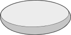 | `baduk-white` | 흰 바둑돌 | 61.4×38.4 | — | base·top·center | 사물 바둑돌 규칙찾기 |
| 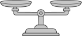 | `balance-scale` | 양팔저울 | 140×110 | — | base·top·center | 사물 저울 등식 |
| 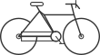 | `bicycle` | 자전거 | 110.4×61.2 | ○ | base·top·center | 탈것 거리 속력 |
| 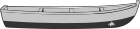 | `boat` | 배 | 127.4×54.9 | ○ | top·center | 탈것 강 유속 속력 |
| 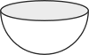 | `bowl` | 반구 그릇 | 100×62 | — | base·top·center | 사물 부피 반구 |
| 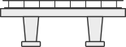 | `bridge` | 다리 | 155.4×58.4 | ○ | base·top·center | 야외 거리 속력 다리 |
|  | `building` | 건물 | 79.4×109.4 | ○ | base·top·center | 야외 높이 비교 |
| 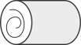 | `cake-roll` | 롤케이크 | 103.4×57.4 | — | base·top·center | 음식 부피 원기둥 |
| 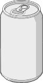 | `can` | 음료 캔 | 47.4×82.2 | — | base·top·center | 사물 원기둥 끈묶기 |
| 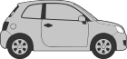 | `car-side` | 자동차 | 134×56.4 | ○ | base·top·center | 탈것 거리 속력 |
|  | `cup-cone` | 원뿔 컵 | 57.4×81.4 | — | base·top·center | 사물 들이 원뿔 |
| 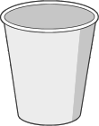 | `cup-cylinder` | 원기둥 컵 | 57.4×79.4 | — | base·top·center | 사물 들이 원기둥 |
| 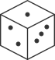 | `dice` | 주사위 | 71.4×77.4 | — | base·top·center | 사물 주사위 확률 경우의수 |
| 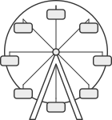 | `ferris-wheel` | 관람차 | 140×150 | — | base·top·center | 야외 높이 회전 삼각함수 |
|  | `flagpole` | 깃대 | 61.4×124.4 | ○ | base·top·center | 야외 높이 |
| 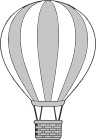 | `hot-air-balloon` | 열기구 | 90×130 | ○ | top·center | 야외 높이 올려본각 |
| 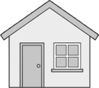 | `house` | 집 | 100×100 | ○ | base·top·center | 야외 높이 그림자 |
| 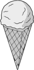 | `ice-cream-cone` | 아이스크림콘 | 56.2×97.4 | — | top·center | 음식 원뿔 반구 |
| 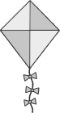 | `kite` | 연 | 80×110 | ○ | top·center | 야외 올려본각 삼각함수 |
| 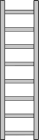 | `ladder` | 사다리 | 44×120 | ○ | base·top·center | 사물 높이 피타고라스 |
|  | `lighthouse` | 등대 | 64×140 | ○ | base·top·center | 야외 높이 올려본각 삼각함수 |
|  | `matchstick` | 성냥개비 | 80×110 | — | base·top·center | 사물 성냥개비 규칙찾기 |
| 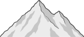 | `mountain` | 산 | 145.4×71.4 | ○ | base·top·center | 야외 등산 거리 속력 |
|  | `person-standing` | 서 있는 사람 | 37×92.4 | ○ | base·top·center | 사람 높이 속력 |
| 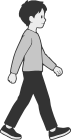 | `person-walking` | 걷는 사람 | 57.4×92.5 | ○ | base·top·center | 사람 걷기 거리 속력 |
| 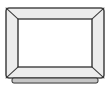 | `picture-frame` | 액자 | 110×90 | — | base·top·center | 사물 액자 규칙찾기 자석 |
| 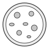 | `pizza` | 피자 | 100×100 | — | top·center | 음식 원 부채꼴 |
| 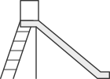 | `slide` | 미끄럼틀 | 140×100 | ○ | base·top·center | 야외 높이 피타고라스 |
|  | `streetlamp` | 가로등 | 29.4×109.4 | ○ | base·top·center | 야외 높이 그림자 |
| 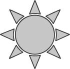 | `sun` | 해 | 80×80 | ○ | top·center | 야외 그림자 각도 |
| 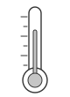 | `thermometer` | 온도계 | 80×110 | — | top·center | 사물 온도 정수 영하 |
| 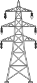 | `tower` | 탑 | 70×150 | ○ | base·top·center | 야외 높이 삼각함수 |
| 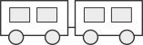 | `train-side` | 기차 | 157.4×50.4 | ○ | base·top·center | 탈것 거리 속력 터널 |
| 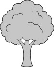 | `tree` | 나무 | 60×90 | ○ | base·top·center | 야외 높이 |
| 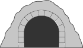 | `tunnel` | 터널 | 125.4×70.8 | ○ | base·top·center | 야외 거리 속력 터널 |
| 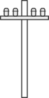 | `utility-pole` | 전봇대 | 70×140 | ○ | base·top·center | 야외 높이 그림자 |
| 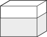 | `water-tank` | 수조 | 97.4×77.4 | — | base·top·center | 사물 부피 물높이 |

## 기준점 (`anchors.json`)

39종 모두 `top`과 `center`를 제공한다. `base`는 바닥에 놓이거나 서는 물체만 제공하며, 비행기·열기구·연·해·배·아이스크림콘·온도계·위에서 본 피자에는 생략한다.

좌표는 viewBox 단위이며 선 굵기를 포함한 실제 잉크 끝을 기준으로 한다. `center`는 보조선까지 포함한 전체 잉크 상자의 가운데이며, 브라우저에서 10배로 렌더링하여 0.1 단위로 측정했다. `base`는 바닥선·물결을 제외한 물체의 접지 부분 가운데다. 떨어진 두 발·바퀴·기둥은 접지 범위를 합친 가운데를 쓴다. `top`은 높이 문제에 쓰는 꼭대기다(산은 깃발이 아닌 산봉우리, 가로등은 등 머리 위쪽). 사다리는 가운데 위 (22, 0)을 쓴다.

수정한 그림과 새 12종의 잉크는 viewBox 네 변에 닿는다. `base`와 `top`의 x가 다른 그림은 높이를 계산할 때 y 차이를 사용한다. `center`는 무게중심이나 원 중심을 뜻하지 않는다.
